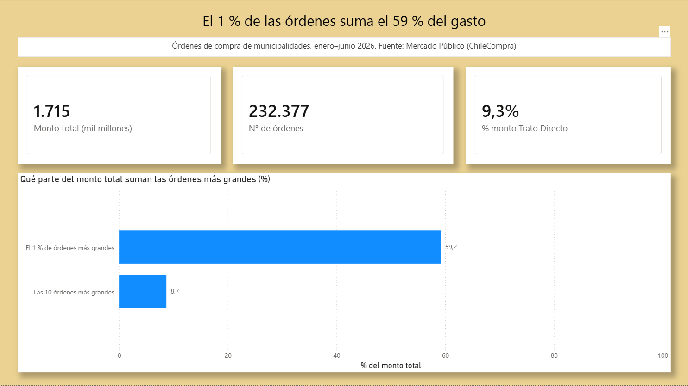
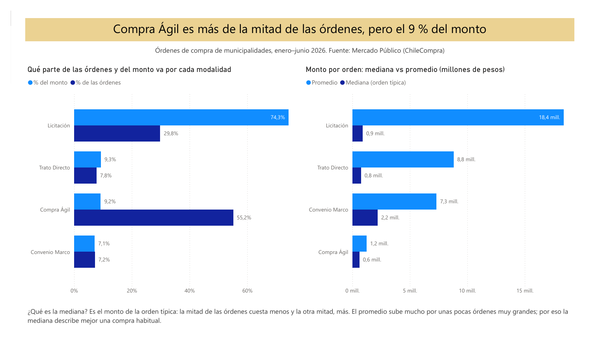
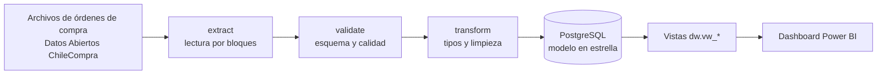

# Compras públicas: ¿cómo compra una municipalidad?

Pipeline de datos y dashboard que responden, para una jefa de abastecimiento (usuaria ficticia),
cuatro preguntas sobre las órdenes de compra de **Mercado Público (ChileCompra)**: cómo se reparte el
gasto por modalidad, cuánto se concentra en pocos proveedores, cuándo se gasta y qué órdenes se
salen de lo habitual.

> **Estado:** el ETL, el modelo SQL y el dashboard de Power BI (5 páginas) están probados con datos reales de
> ChileCompra (primer semestre de 2026, sector Municipalidades). Las cifras del dashboard se revisaron contra consultas SQL.

## El problema

Paula emite cientos de órdenes de compra al mes y arma reportes a mano en Excel. No sabe si compra
bien comparado con lo normal, ni dónde mirar cuando auditoría pregunta. Detalle del levantamiento
en [`docs/01_requerimientos.md`](docs/01_requerimientos.md).

## Resultados

**232.377 órdenes de compra** de 415 organismos municipales, del 1 de enero al 30 de junio de 2026, por unos
$1.715 mil millones. Detalle y consultas en [`docs/03_hallazgos.md`](docs/03_hallazgos.md).

1. **El 1 % de las órdenes concentra el 59 % del gasto.** Las licitaciones son el 74 % del monto pero el 30 % de las órdenes; la orden típica vale casi lo mismo en todas las modalidades.
2. **Una sola orden puede dominar el gasto de un municipio** (en un caso, el 90 %), así que un índice de concentración alto no siempre significa dependencia de un proveedor.
3. **El volumen de trabajo está en Compra Ágil:** 55 % de las órdenes, pero 9 % del monto.

Estos son patrones en los datos, no juicios sobre instituciones o personas.

## Dashboard

Cinco páginas, cada una con un titular que resume el hallazgo: Resumen, Modalidades, Concentración, Evolución y Alertas
(órdenes sobre el percentil 99 de su rubro). Guía de páginas en [`dashboard/README.md`](dashboard/README.md).





Más capturas (Concentración, Evolución y Alertas) en [`dashboard/capturas/`](dashboard/capturas/). La página de alertas muestra el código de la orden, el
organismo y el rubro, pero no el proveedor: algunos proveedores son personas naturales.

## Cómo funciona



- **Incremental:** un archivo con el mismo hash no se vuelve a cargar; las cargas son idempotentes.
- **Con validaciones:** se rechaza un archivo sin columnas obligatorias o con fechas/montos inservibles.
- **Con reintentos y alertas:** la carga reintenta ante fallos y avisa por Slack si defines `SLACK_WEBHOOK_URL`.

## Cómo correrlo

**Requisitos:**
- Python 3.10 o superior.
- PostgreSQL 16 o superior (el instalador oficial de postgresql.org incluye `psql`).
- Power BI Desktop, para abrir el dashboard.
- Docker **no es necesario**. Hay una alternativa con Docker al final de esta sección.

Los comandos están escritos para **cmd** (Símbolo del sistema de Windows). Ejecútalos desde la carpeta raíz del repo.

| Acción | cmd | PowerShell | macOS / Linux |
|---|---|---|---|
| Codificación del cliente | `set PGCLIENTENCODING=UTF8` | `$env:PGCLIENTENCODING = "UTF8"` | `export PGCLIENTENCODING=UTF8` |
| Agregar `psql` al PATH | `set PATH=%PATH%;C:\Program Files\PostgreSQL\16\bin` | `$env:Path += ";C:\Program Files\PostgreSQL\16\bin"` | normalmente ya está |
| Crear entorno | `py -m venv .venv` | `py -m venv .venv` | `python3 -m venv .venv` |
| Activar entorno | `.venv\Scripts\activate.bat` | `.venv\Scripts\Activate.ps1` | `source .venv/bin/activate` |
| Copiar configuración | `copy .env.example .env` | `Copy-Item .env.example .env` | `cp .env.example .env` |

En las rutas de los scripts, cmd usa `\` (`sql\01_schema_estrella.sql`); PowerShell y macOS/Linux aceptan `/`.
Cambia `16` por tu versión de PostgreSQL.

### Contraseñas: son tres y no se mezclan

| Usuario | Contraseña | Para qué sirve |
|---|---|---|
| `postgres` | la que elegiste al instalar PostgreSQL | administrar el servidor (crear usuarios y bases) |
| `compras` | `compras` | dueño de la base; la usan el ETL y los scripts `01`, `02` y `04` |
| `lector` | `lector` | solo lectura; la usa el dashboard |

- Al escribir una contraseña en `psql` **no se ve nada en pantalla**, ni asteriscos. Es normal.
- **No uses `set PGPASSWORD=...`.** Si lo ejecutas, `psql` usa ese valor sin preguntarte nada y falla con
  «la autentificación password falló» cuando le toca otro usuario. Si ya lo usaste, límpialo con `set PGPASSWORD=`.
- La contraseña `compras` coincide con `DATABASE_URL` en `.env.example`. Si usas otra, cámbiala también ahí.

### 1. Base de datos

```bat
cd /d C:\ruta\a\compras-publicas-analytics
set PGCLIENTENCODING=UTF8
set PATH=%PATH%;C:\Program Files\PostgreSQL\16\bin
psql --version

psql -U postgres -c "CREATE USER compras WITH PASSWORD 'compras';"
psql -U postgres -c "CREATE DATABASE compras OWNER compras;"
psql -U compras  -d compras -f sql\01_schema_estrella.sql
psql -U compras  -d compras -f sql\02_vistas_kpi.sql
psql -U postgres -d compras -f sql\03_rol_lectura.sql
psql -U compras  -d compras -f sql\04_vistas_dashboard.sql
psql -U compras  -d compras -c "\dv dw.*"
```

El orden importa: `04` da permisos al usuario `lector`, que se crea en `03`. Cada comando pide la contraseña del
usuario que aparece en `-U` (ver tabla anterior). El último comando debe listar **ocho vistas**:
`vw_gasto_por_modalidad`, `vw_top_proveedores_organismo`, `vw_concentracion_organismo`, `vw_tiempo_aceptacion`,
`vw_estacionalidad`, `vw_oc_atipicas`, `vw_estadisticas_modalidad` y `vw_concentracion_ordenes`.

> Las credenciales de `03_rol_lectura.sql` son de demostración: cámbialas si la base queda accesible a otras personas.

### 2. Entorno de Python

```bat
py -m venv .venv
.venv\Scripts\activate.bat
copy .env.example .env
python -m pip install -r requirements.txt
```

Si `py` no funciona, usa `python -m venv .venv`. Con el entorno activo, la línea empieza con `(.venv)`;
en cada terminal nueva basta con repetir la activación.
La configuración (`DATABASE_URL`, `SLACK_WEBHOOK_URL`, etc.) se lee del archivo `.env`.

### 3. Probar con datos sintéticos

Antes de descargar archivos reales, comprueba que todo conecta. Hazlo en una base de prueba o
[empieza de cero](#empezar-de-cero) antes de cargar los datos reales: los datos sintéticos no deben mezclarse con ellos.

```bat
python data\sample\generar_muestra.py
python -m etl.run inspect data\sample\ordenes_muestra.csv
python -m etl.run load data\sample\ordenes_muestra.csv

psql -U compras -d compras -c "SELECT COUNT(*) FROM dw.fact_orden_compra;"
psql -U compras -d compras -c "SELECT * FROM dw.vw_gasto_por_modalidad;"
```

- `inspect` debe terminar en `Resultado: OK`.
- `load` debe terminar en `ordenes_muestra.csv cargado: 300 filas`.
- El `COUNT` debe devolver **300**, y la vista, el gasto repartido en cuatro modalidades.

Son datos inventados: sirven para validar el pipeline, no para sacar conclusiones.

Pruebas automáticas (con el entorno activo): `pytest`

### 4. Datos reales

Descarga desde [Datos Abiertos ChileCompra](https://datos-abiertos.chilecompra.cl/descargas) los archivos de órdenes
de compra (uno por modalidad) y guárdalos en `data\raw\`. Este proyecto usa el primer semestre de 2026, sector
Municipalidades. Los archivos no traen una columna de modalidad, así que se carga cada uno indicándola:

```bat
python -m etl.run inspect data\raw\14TratoDirecto.csv

python -m etl.run load data\raw\14TratoDirecto.csv   --modalidad "Trato Directo"
python -m etl.run load data\raw\14CompraAgil.csv     --modalidad "Compra Ágil"
python -m etl.run load data\raw\14ConvenioMarco.csv  --modalidad "Convenio Marco"
python -m etl.run load data\raw\14OCLicitacion.csv   --modalidad "Licitación"
```

Los nombres de archivo pueden variar según la descarga. Si `inspect` dice que faltan columnas obligatorias,
ajusta `COLUMN_ALIASES` en `etl\config.py` con los nombres reales que muestra.

### 5. Dashboard

Abre `DashboardsComprasPublicas.pbip` con Power BI Desktop. La primera vez pide las credenciales de PostgreSQL
(`localhost:5432`, base `compras`): usa el usuario `lector`. Luego pulsa **Actualizar** en la pestaña **Inicio**.

### Si algo falla

| Mensaje o síntoma | Causa | Solución |
|---|---|---|
| `'psql' no se reconoce como un comando` | PostgreSQL no está en el PATH | `set PATH=%PATH%;C:\Program Files\PostgreSQL\16\bin` (solo vale para esa ventana) |
| `la autentificación password falló para el usuario «compras»` | `PGPASSWORD` con un valor viejo, o `compras` creado con otra clave | `set PGPASSWORD=` y luego `psql -U postgres -c "ALTER USER compras WITH PASSWORD 'compras';"` |
| El error anterior sigue y menciona `::1` | Conexión por IPv6 | Agrega `-h 127.0.0.1` al comando de `psql` |
| `role "compras" does not exist` o `database "compras" does not exist` | No se alcanzó a crear | Repite los dos `CREATE` del paso 1 |
| `role "lector" does not exist` al correr `04` | Se corrió `04` antes que `03` | Corre `03` y luego repite `04` |
| `'py' no se reconoce` | Python no está en el PATH con ese nombre | Usa `python` en vez de `py` |
| Acentos raros en los mensajes (`función`) | Solo es visual: la consola de cmd | `chcp 65001`; no afecta a los datos |
| `ModuleNotFoundError` al correr el ETL | Entorno sin activar o dependencias sin instalar | Activa `.venv` y repite `python -m pip install -r requirements.txt` |
| Power BI: «Se encontró una referencia cíclica durante la evaluación» al actualizar | Falla de Power BI al actualizar todas las tablas a la vez | En el panel **Datos**, clic derecho en cada tabla → **Actualizar datos** |

### Empezar de cero

Borra la base y los usuarios (pide la contraseña de `postgres`) y repite desde el paso 1:

```bat
psql -U postgres -c "DROP DATABASE IF EXISTS compras WITH (FORCE);"
psql -U postgres -c "DROP ROLE IF EXISTS lector;"
psql -U postgres -c "DROP ROLE IF EXISTS compras;"
```

Respeta el orden: primero la base, después los usuarios.

### Alternativa: la base de datos con Docker (opcional)

Si tienes Docker Desktop, puedes reemplazar el paso 1 completo por un solo comando: el contenedor
ejecuta los scripts de `sql/` la primera vez que arranca.

```bat
docker compose up -d db
```

Docker Desktop no está disponible en todas las ediciones de Windows; si no puedes instalarlo, usa el camino
principal de arriba. También puedes levantar el ETL en contenedor con
`docker compose --profile etl run --rm etl`. Si ya tienes PostgreSQL local usando el puerto 5432,
cambia el puerto en `docker-compose.yml` y en `.env`.

## Estructura

```
docs/        requerimientos, mapa del proceso, hallazgos
sql/         esquema en estrella, vistas de KPI, usuario de lectura, vistas del dashboard
etl/         extract, validate, transform, load, run
dashboard/   guía de páginas y capturas
DashboardsComprasPublicas.pbip (+ carpetas .Report y .SemanticModel)   proyecto de Power BI
tests/       pruebas del ETL
data/sample/ datos sintéticos para probar
Dockerfile, docker-compose.yml   (opcional) base de datos y ETL en contenedores
```

## Decisiones y límites

- **Solo órdenes de compra.** Las licitaciones darían tiempos de adjudicación, pero requieren otro modelo.
- **Un semestre.** No se puede evaluar estacionalidad anual ni el cierre de año.
- **Los archivos no traen fecha de aceptación**, así que `vw_tiempo_aceptacion` queda vacía y no forma parte del dashboard.
- **Una fila por ítem en el origen:** el ETL conserva una fila por orden de compra.
- **Monto = `MontoNetoOC_CLP`** (neto, en pesos, sin impuestos). Las 20 órdenes sin monto (0,009 %) no suman.
- **Los nombres de columna son configurables** (`COLUMN_ALIASES`), porque los archivos oficiales pueden variar.
- **El pipeline reproduce lo que dice el archivo:** no se verificó la exactitud de los montos en el origen.
- **Los atípicos no son irregularidades:** son órdenes que merecen revisión, nada más.
- **Datos públicos.** Revisa los términos de uso de ChileCompra antes de redistribuir archivos; por eso `data/raw/` no se versiona.

## Qué se probó y qué no

**Probado:**
- Con datos sintéticos: lectura, mapeo de columnas, limpieza y validaciones (`pytest`).
- En Windows 10 con PostgreSQL local: creación de la base, esquema y vistas (se corrigió un error de tipos en `vw_oc_atipicas` que apareció aquí).
- Con archivos reales de ChileCompra (4 modalidades, sector Municipalidades, primer semestre de 2026): carga completa de 232.377 órdenes y consultas sobre las vistas. Aquí se ajustó `COLUMN_ALIASES` y se relajó la validación de códigos repetidos.
- El dashboard de Power BI: las cifras de las cinco páginas coinciden con consultas SQL sobre la base.

**Aún no probado o con problemas conocidos:**
- La alternativa con Docker.
- En Power BI, actualizar todas las tablas a la vez falló con un error de «referencia cíclica»; actualizar tabla por tabla funciona.

## Licencia

El código está bajo licencia MIT (ver [`LICENSE`](LICENSE)). Los datos son de ChileCompra y no se incluyen en el repositorio.
