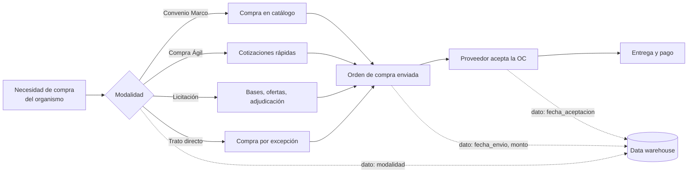

# Mapa del proceso

Versión simplificada del proceso de compra y de dónde se origina cada dato. **Es un borrador:**
valídalo con la documentación de ChileCompra y redibújalo en BPMN (Bizagi) para el portafolio;
guarda el diagrama como `docs/02_proceso_bpmn.png`.

## Ciclo de vida del dato en este proyecto

1. **Origen:** archivos de órdenes de compra de la sección Descargas de Datos Abiertos de ChileCompra.
2. **Ingesta:** `etl/extract.py` lee por bloques; ya cargado = mismo hash, se omite.
3. **Calidad:** `etl/validate.py` rechaza archivos con esquema o fechas inservibles.
4. **Modelo:** `etl/sql/load_from_staging.sql` actualiza dimensiones y hechos (idempotente).
5. **Consumo:** vistas `dw.vw_*` → dashboard de Power BI.

## Puntos de dolor del proceso de datos (para la sección de mejoras)
- Los archivos vienen separados por modalidad y semestre: hay que unirlos antes de comparar.
- Los nombres de columna y formatos de fecha/monto no siempre son consistentes.
- Un mismo proveedor u organismo puede aparecer con nombres distintos si falta el RUT.
